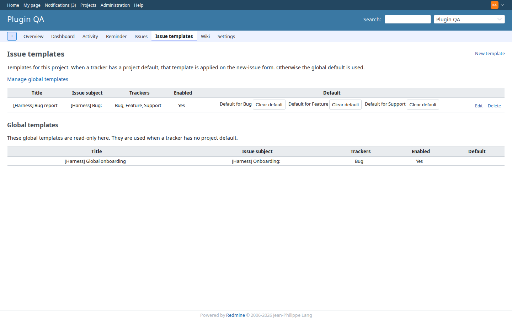
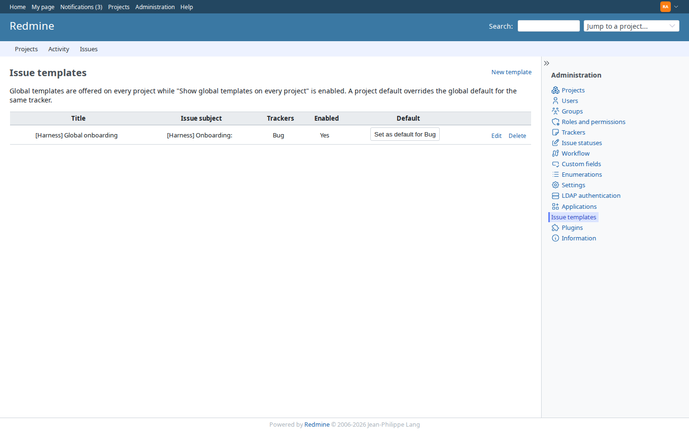
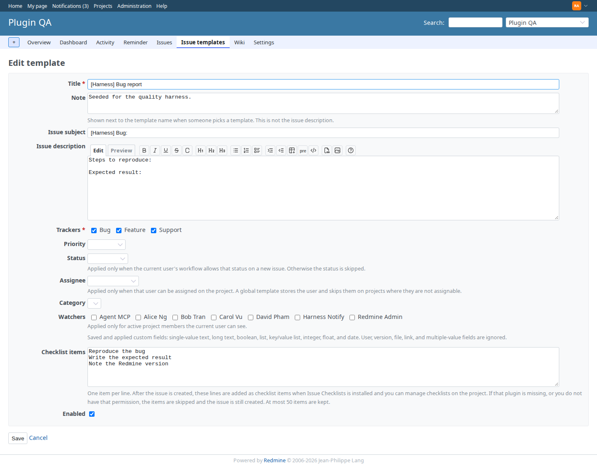
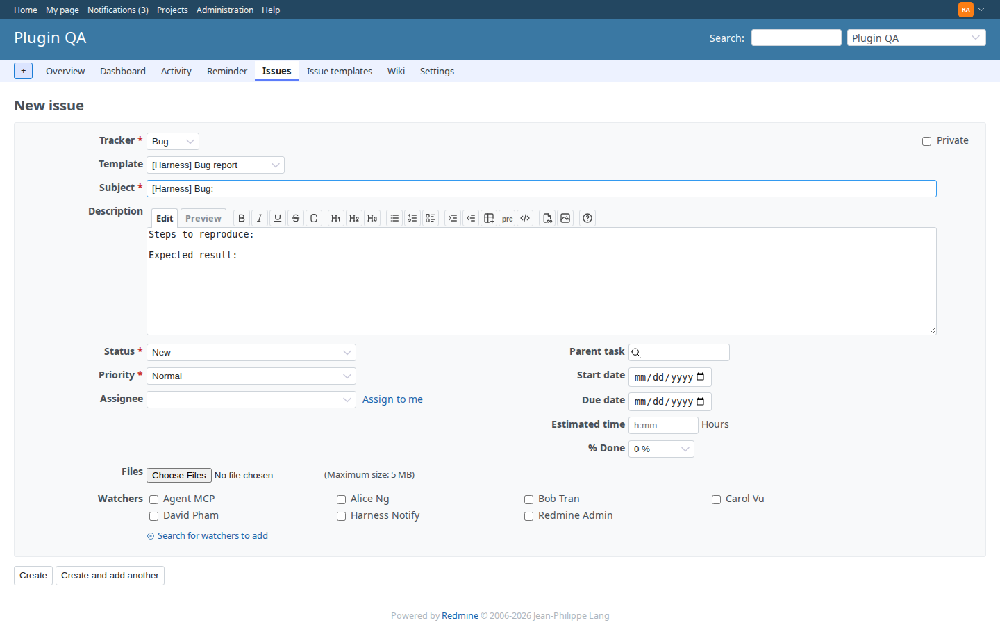
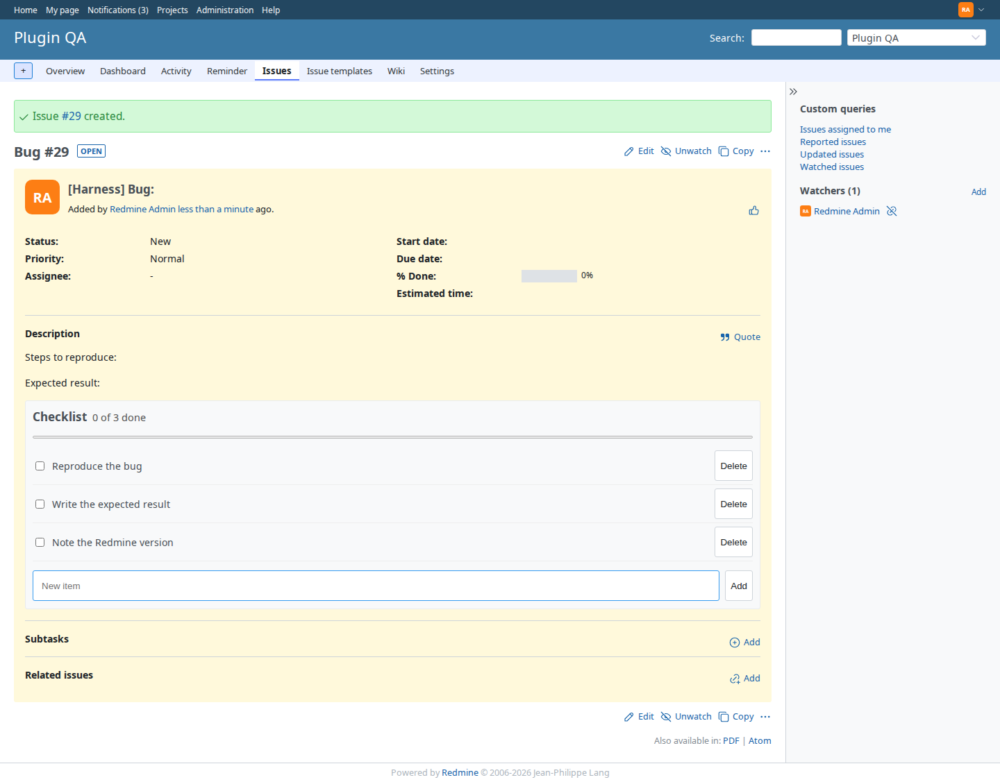

# Issue Templates

[](https://github.com/redmineshop/redmine_issue_templates/actions/workflows/ci.yml)
[](LICENSE)

**Source on GitHub:** [github.com/redmineshop/redmine_issue_templates](https://github.com/redmineshop/redmine_issue_templates)

Start a new issue from a reusable template on Redmine 7.0. When Issue Checklists is installed, a template can add checklist items after the issue is created.

Templates fill the create form: subject, description, tracker, and the optional fields listed below. Checklists track work after the issue exists. When Issue Checklists is installed, a template can add checklist items after the issue is created.

## Screenshots

Project template list:



Administration template list:



Template form, including checklist items when Issue Checklists is installed:



New issue with a template applied:



Checklist items seeded on the created issue:



## What you can do

- Create **project templates** (project menu → Issue templates) and **global templates** (Administration → Issue templates)
- Link each template to one or more trackers
- Set or clear a **default template per tracker**. The project default wins. The global default is the fallback when global templates are enabled
- On **Issues → New**, pick a template or receive the default for the tracker
- Fill **subject**, **description**, **tracker**, and, when they are allowed:
  - priority
  - status, only if your workflow allows it on a new issue
  - assignee, only if that user can be assigned on the project
  - category, only if it belongs to the project
  - watchers who are active project members you can see
  - custom fields on the whitelist below
- Ask before replacing subject and description when the tracker changes to one that has a default (on by default)
- Ask before replacing those fields when you pick a template and they already have text
- Store **checklist items** (one per line) when Issue Checklists is installed. After the issue is created, those lines are added as checklist items if you can manage checklists on the project. At most 50 items. If the plugin is missing, the association is missing, or you lack that permission, the items are skipped and the issue is still created

### Custom fields that are applied

Single-value only:

| Applied | Ignored |
| --- | --- |
| string, text, boolean, list, key/value list (enumeration), integer, float, date | user, version, attachment/file, link, any other format, any multiple-value field |

Values that are not on the whitelist are not saved from the template form. If a stored value is still unsafe, or the current user cannot use it, the new-issue request omits it and the form shows a short notice. The issue is still created with the fields that were allowed.

## What this plugin does not do

- Does not apply a template while editing an existing issue
- Does not import data from the classic `redmine_issue_templates` plugin
- Does not require Issue Checklists. The checklist field is hidden when that plugin is not installed

## Do not install beside the classic plugin

This plugin's folder is `redmine_issue_templates`. That is the same folder name as the classic plugin (akiko-pusu and the agileware-jp fork). This build is for Redmine 7.0 and newer. It is not the classic plugin.

Uninstall the classic plugin and restart Redmine before installing this one. Side-by-side use is **unsupported**. Both plugins add a control to the new-issue form, and Redmine cannot load two plugins with this id. The same warning is on the plugin settings page (**Administration → Plugins → Issue Templates → Configure**).

## Requirements

| Target | Status |
| --- | --- |
| Redmine 7.0.1 | Verified by plugin tests on the official `redmine:7.0.1` image (Ruby 4.0.7, Rails 8.1.3.1, SQLite), with Issue Checklists mounted for the seed path. Counts are in the Tests section. |
| Redmine 7.0.0 and 7.1 | Declared by `requires_redmine version_or_higher: '7.0'`. Not run. |
| Redmine 6.1 and older | Not supported. |
| Database | MySQL 8 or PostgreSQL in production. The test run uses SQLite. |
| Other plugins | None required. Issue Checklists is optional. No Vue, no deface, no extra gems. |

On 2026-09-25, `test/run-redmine-7.0.1.sh` passed on the official `redmine:7.0.1` image (SQLite, Ruby 4.0.7, Rails 8.1.3.1) with Issue Checklists mounted: 71 runs, 347 assertions, 0 failures. The same day, `./demo/scripts/run-plugin-e2e.sh tests/redmine_issue_templates.spec.js` passed on `docker-compose.demo.yml` (demo image Redmine 7.0.1, MySQL 8, Issue Checklists installed): 1 passed. That run is **verified** in `demo/e2e/plugins.yml`. Redmine 7.0.0, 7.1, and PostgreSQL were not part of either run.

## Installation

The plugin directory must be named `redmine_issue_templates`.

```bash
cd /path/to/redmine/plugins
git clone https://github.com/redmineshop/redmine_issue_templates.git
cd /path/to/redmine
RAILS_ENV=production bundle exec rake redmine:plugins:migrate NAME=redmine_issue_templates
# restart Redmine
```

Docker:

```bash
docker exec -e RAILS_ENV=production <redmine-container> \
  bundle exec rake redmine:plugins:migrate NAME=redmine_issue_templates
docker restart <redmine-container>
```

Then:

1. Open the project → **Settings → Modules** and enable **Issue Templates**.
2. **Administration → Roles and permissions**: grant **Use issue templates** to roles that create issues, and **Manage issue templates** to roles that edit them.
3. If you want checklist items from a template, install Issue Checklists and grant **Manage checklists** (the Issue Checklists permission) to the roles that create those issues. Without that permission the issue is still created and the items are skipped.
4. **Administration → Issue templates** for global templates. **Project menu → Issue templates** for templates on that project.
5. Optional: on a template, set it as the default for a tracker.

Uninstall drops the three `community_issue_*` tables:

```bash
RAILS_ENV=production bundle exec rake redmine:plugins:migrate NAME=redmine_issue_templates VERSION=0
```

Remove the plugin folder and restart.

## Settings

| Setting | Default |
| --- | --- |
| Ask before replacing fields when the tracker changes to one with a default template | On |
| Show global templates on every project | On |

Turning the confirm setting off overwrites subject and description when a tracker change applies a default, without a dialog. Picking a template by hand still asks when those fields already have text.

Changing status or priority on the new issue does not apply a template again.

## Checklist items

The template form shows **Checklist items** only when `redmine_issue_checklists` is installed. Lines are stored on the template. They are not sent to the browser as part of the new-issue JSON.

When the new issue is saved and a template was selected:

1. If Issue Checklists is not installed, nothing else happens.
2. If the issue has no `issue_checklists` association, nothing else happens.
3. If the current user cannot `manage_issue_checklists` on the project, the items are skipped. Permission is not raised.
4. Otherwise each non-blank line becomes an `IssueChecklist` row (`is_done: false`, position 1, 2, 3, …), up to `IssueChecklist::MAX_ITEMS_PER_ISSUE` (50).

A failure while creating those rows is logged and does not undo the issue.

## Tests

From a Redmine 7.0+ application that has this plugin under `plugins/`:

```bash
RAILS_ENV=test bundle exec rake redmine:plugins:migrate NAME=redmine_issue_templates
RAILS_ENV=test bundle exec rake redmine:plugins:test NAME=redmine_issue_templates
```

The official `redmine:7.0.1` image omits the Gemfile `:test` group. `test/run-redmine-7.0.1.sh` installs that group and runs the suite on SQLite. If `redmine_issue_checklists` sits next to this plugin, or `CHECKLISTS_PLUGIN_DIR` points at it, the script mounts it so checklist rows are created for real.

The tests cover permission denial, create/update/destroy, default per tracker, the JSON fields applied on the new-issue form, the custom-field whitelist, and checklist seeding when the checklists plugin is present, absent, or the user lacks `manage_issue_checklists`. DDL `down` is not executed inside the transactional suite, because MySQL commits on `DROP TABLE`. The migration class defines `down` and a unit test asserts those `drop_table` calls are present.

Latest run, official image `redmine:7.0.1`, SQLite, Ruby 4.0.7, Rails 8.1.3.1, after installing the Gemfile `:test` group, with `redmine_issue_checklists` loaded in the same process:

```text
71 runs, 347 assertions, 0 failures, 0 errors, 0 skips
```

## License

GNU General Public License version 2. See [LICENSE](LICENSE).
